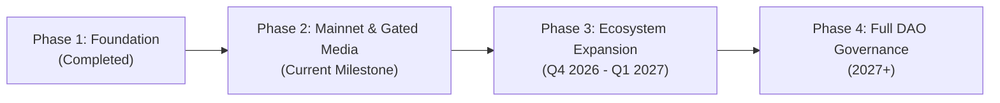

# TRUST LESSON — PITCH DECK INFORMATION & PROTOCOL DOSSIER
**The Decentralized Trust Layer for Peer-to-Peer Mentorship & Skill Accreditation**
*Network: Arbitrum One (L2) • Currency: USDC • Version: 2.1.0*

---

## 1. EXECUTIVE SUMMARY & ONE-LINER

> **"Trust Lesson is a decentralized, milestone-escrow protocol on Arbitrum that eliminates fraud in peer-to-peer mentorship, protects mentors' earnings with zero platform cut on their base fee, gates intellectual property with short-lived cryptographic tokens, and issues non-transferable Soulbound Credentials backed by on-chain proofs."**

### Core Highlights
* **Zero Trust Dilemma:** Learners deposit funds into a non-custodial smart contract escrow on Arbitrum L2; mentors receive payouts milestone-by-milestone only when deliverables are verified.
* **100% Mentor Earnings Guarantee:** Mentors keep 100% of their quoted hourly/package rate. The protocol charges a transparent, buyer-side platform fee.
* **Zero Gas Friction:** 100% of blockchain transaction gas is subsidized through an automated Platform Paymaster Relayer ($0 ETH spent by users).
* **Anti-Piracy Content Gating:** Dual-tier curriculum storage (Cloudflare Stream/R2 with 1-hour/15-minute signed URL tokens, plus a zero-cost YouTube Unlisted / Google Drive Restricted tier for bootstrap mentors).
* **Verifiable On-Chain Reputation:** Non-transferable Soulbound Tokens (SBTs) conform to W3C Verifiable Credentials and EIP-712 standards, generating an immutable proof-of-competence graph.

---

## 2. THE PROBLEM: WHY WEB2 MENTORSHIP IS BROKEN

The global online education and 1-on-1 coaching market exceeds \$30 Billion, yet peer-to-peer knowledge transfer is plagued by systemic distrust:

### 1. The Learner's Dilemma (Upfront Payment Risk)
* Learners are routinely forced to transfer funds upfront via wire transfer or Web2 platforms with zero delivery guarantees.
* Unqualified "gurus" ghost after receiving payment, deliver superficial sessions, or provide outdated materials with no refund recourse.

### 2. The Mentor's Dilemma (Chargebacks & Unpaid Overtime)
* Mentors spend hours preparing custom curricula and reviewing code, only to face credit card chargebacks, delayed payouts, or non-payment from international clients.

### 3. Exorbitant Web2 Platform Taxes
* Incumbent platforms (Upwork, Superprof, Udemy, Preply) deduct **20% to 50%+** from instructors' hard-earned income to maintain heavy middleman overhead.
* Payouts often take 14 to 30 days to clear international banking rails with steep foreign exchange cuts.

### 4. Intellectual Property Piracy
* Instructors uploading proprietary slides, source code, and video lectures have their raw links leaked to public forums and Telegram channels, destroying course value.

### 5. Resume Fraud & Unverifiable Certificates
* Traditional PDF certificates and LinkedIn badges are easily forged. Employers and DAOs have no cryptographic method to verify whether a candidate actually completed real hands-on mentorship.

---

## 3. THE SOLUTION: THE TRUST LESSON ECOSYSTEM

Trust Lesson introduces a trust-minimized, programmable settlement and reputation infrastructure:

```
┌────────────────────────────────────────────────────────────────────────┐
│                        TRUST LESSON VALUE LOOP                         │
├────────────────────────────────────────────────────────────────────────┤
│                                                                        │
│   [Learner] ──── Deposit USDC ───► [EscrowRouter.sol] (Arbitrum L2)    │
│       ▲                                    │                           │
│       │ Release Milestone                  │ Guaranteed Payout         │
│       │                                    ▼                           │
│   [Soulbound SBT] ◄── Auto-Mint ──── [Verified Mentor]                 │
│       ▲                                    │ Staked Collateral         │
│       │                                    ▼                           │
│   [SkillGraph] ◄── Verifiable Proof ── [MentorStaking.sol]             │
│                                                                        │
└────────────────────────────────────────────────────────────────────────┘
```

1. **Smart Milestone Escrow (`EscrowRouter.sol`):**
   Funds remain locked in an audited smart contract on Arbitrum One until both parties confirm milestone deliverables.
2. **Economic Stake Collateral (`MentorStaking.sol`):**
   Mentors stake USDC (minimum 100 USDC) to earn a "Verified Mentor" badge. In case of proven fraud or absenteeism, their stake is programmatically slashed to reimburse the student.
3. **Dual-Party Soulbound Credentials (`VerifiableCredential.sol`):**
   Completing a session programmatically mints non-transferable Soulbound Tokens to both student (proof of mastery) and mentor (proof of delivery), linked to an on-chain `SkillGraph`.
4. **Decentralized Dispute Governance (`DisputeCouncil.sol`):**
   Disputes are reviewed by an on-chain sortition panel of high-reputation community jurors, eliminating unilateral platform bias.

---

## 4. PRODUCT PILLARS & ARCHITECTURAL ADVANTAGES

### Pillar 1: Frictionless Web2 / Web3 Hybrid Onboarding
* **Dual Authentication Engine:** Users can authenticate via **Sign-In with Ethereum (SIWE)** or fallback to Web2 email/password with instant custodial key management.
* **Gasless Paymaster (`lib/gasSponsor.js`):** Built-in relayer subsidizes all L2 gas fees. Users never need to acquire or manage ETH for transaction fees.
* **Fiat On-Ramp Integration:** Integrated Transak widget enables learners to fund escrows directly via Credit Card, Debit Card, Apple Pay, or Google Pay.

### Pillar 2: Dual-Tier Content Protection & Anti-Piracy
* **Tier 1 (Enterprise Encrypted Storage):**
  * Video: Native multipart streaming directly to **Cloudflare Stream**, returning internal UIDs with no public playback URLs. Playback requires a 1-hour signed token issued only after on-chain escrow verification.
  * Documents: Private **Cloudflare R2** bucket with short-lived (15-minute) AWS SigV4 presigned download links.
* **Tier 2 (Zero-Cost Free Alternative for Bootstrapping Mentors):**
  * Allows mentors to embed **YouTube Unlisted** video links and **Google Drive Restricted** document links, protected by platform escrow gating and an interactive step-by-step privacy configuration guide.

### Pillar 3: On-Chain Reputation & Skill Graph
* Rather than isolated star ratings, achievements feed into `SkillGraph.sol`, mapping dependencies (e.g., *Solidity Basics* -> *Reentrancy Security* -> *DeFi Architecture*).
* Verified credentials carry W3C JSON-LD compliance and EIP-712 cryptographic digests, allowing external DAOs, recruiters, and job boards to verify skills permissionlessly.

---

## 5. BUSINESS MODEL & PROTOCOL ECONOMICS

Trust Lesson is engineered for long-term protocol sustainability with transparent, predictable unit economics:

| Revenue Stream | Rate / Structure | Mechanism |
| :--- | :--- | :--- |
| **Protocol Platform Cut** | **7% – 10%** (Buyer-side) | Added transparently at checkout; mentor retains 100% of their base fee. |
| **Enterprise Verification API** | **\$0.10 – \$0.50** per check | Paid by recruiting firms and Web3 companies verifying applicant SBT credentials. |
| **Mentor Staking Yield** | Treasury collateral yield | Staked mentor collateral in `MentorStaking.sol` deployed in low-risk Arbitrum native yields. |
| **Dispute Arbitration Fee** | Small percentage of case bond | Allocated to active community jurors participating in `DisputeCouncil.sol` voting. |

### Unit Economics Comparison:
* **Traditional Web2 Tutoring Platform:** Mentor charges \$100 -> Platform takes \$25 to \$40 -> Mentor receives \$60–\$75 (after 14–30 days).
* **Trust Lesson Protocol:** Mentor charges \$100 -> Learner deposits \$107–\$110 -> Mentor receives **\$100 instantly** upon milestone completion -> Protocol collects \$7–\$10 for gas sponsorship and ecosystem treasury.

---

## 6. MARKET OPPORTUNITY & TARGET AUDIENCE

### Total Addressable Market (TAM)
* **Global Online Tutoring Market:** Projected to reach **\$35.8 Billion by 2030** (CAGR: 14.7%).
* **Web3 Developer & Tech Education:** Rapidly growing niche with high willingness-to-pay (\$50 – \$300/hour for senior blockchain, AI, and cybersecurity specialists).

### Target Customer Segments:
1. **Aspiring Web3 Developers & Auditors:** Learners seeking personalized mentorship in Solidity, Cairo, Rust, zero-knowledge proofs, and smart contract security.
2. **Senior Blockchain Practitioners:** Senior protocol engineers, DeFi architects, and security researchers seeking a high-trust, zero-fee platform to monetize their expertise.
3. **Web3 Companies & DAOs:** Organizations looking to sponsor talent cohorts with tamper-proof proof-of-attendance and verified skill certificates.

---

## 7. COMPETITIVE MATRIX

| Feature / Metric | Traditional Web2 (Superprof, Upwork) | Web3 Bounties (Gitcoin, Layer3) | **Trust Lesson** |
| :--- | :---: | :---: | :---: |
| **Settlement Method** | Centralized Escrow (14–30 days) | One-off Bounty Payouts | **Smart Milestone Escrow (L2 Instant)** |
| **Platform Take Rate** | 20% – 50% | 5% – 10% | **0% on Mentor / 7% Buyer Fee** |
| **User Gas Fees** | N/A | High (Paid by User) | **100% Gas Sponsored (\$0.00)** |
| **Anti-Piracy Video Gating**| Unprotected or Raw Links | None | **Dual-Tier Signed-Token Gating** |
| **Credentials** | Unverifiable PDF / Image | Quest Badges / NFTs | **W3C Compliant Soulbound Tokens** |
| **Mentor Accountability**| Centralized Support Ticket | None | **On-Chain Staking & Slashing** |
| **Dispute Adjudication** | Arbitrary Company Reps | Manual Community Admin | **Sortition Juror Council (3-of-5)** |

---

## 8. TECHNOLOGY STACK & SMART CONTRACT SUITE

```text
Frontend Layer:       Next.js 15 (App Router), React 19, Tailwind CSS v4, Radix UI
Backend API:          Hono Web Framework, NeonDB Cloud (PostgreSQL), Prisma ORM
Smart Contracts:      Solidity 0.8.20, Hardhat, OpenZeppelin v5 (ReentrancyGuard, Ownable)
Blockchain Network:   Arbitrum One (Mainnet) / Arbitrum Sepolia (Testnet)
Web3 Client Libs:     Viem v2, Ethers.js v6, Jose (Stateless JWT), EIP-712 Signers
Storage & Media:      Cloudflare Stream, Cloudflare R2, Pinata IPFS, AWS SigV4
Fiat Gateway:         Transak On-Ramp Integration
```

### Audited Smart Contracts Architecture:
1. **`EscrowRouter.sol`:** Non-custodial settlement vault managing `CREATED -> FUNDED -> IN_SESSION -> COMPLETED / DISPUTED -> RESOLVED` state transitions.
2. **`MentorStaking.sol`:** Economic stake lockup requiring 100 USDC with a 7-day unstaking timelock to prevent exit scams.
3. **`VerifiableCredential.sol`:** Portable, non-transferable Soulbound credential minter supporting W3C JSON-LD schema metadata and EIP-712 typed digests.
4. **`SkillGraph.sol`:** Directed Acyclic Graph (DAG) for dynamic on-chain skill progression and prerequisite tier unlocking.
5. **`DisputeCouncil.sol`:** 3-of-5 juror sortition engine drawing from high-reputation mentor pools with conflict-of-interest disqualification.

---

## 9. ROADMAP & MILESTONES



### Phase 1: Core Protocol & Testnet MVP (Completed)
* Solidity contract suite developed and verified on Arbitrum Sepolia.
* SIWE authentication, NeonDB PostgreSQL schema, and gasless paymaster relayer tested.
* 3D card flip certificate generator and academic transcript rubric implemented.

### Phase 2: Mainnet Launch & Gated Media Architecture (Current Milestone)
* Deployment of V2 contracts on Arbitrum One.
* Native Cloudflare Stream and Cloudflare R2 access-gating with 1-hour/15-minute token expirations.
* YouTube Unlisted & Google Drive Restricted fallback tier for cost-conscious creators.
* Pre-publish student view simulator for creators.

### Phase 3: Ecosystem Scaling & Institutional Accreditations (Next Phase)
* Partner onboarding with top Web3 developer DAOs and auditor communities.
* Mobile PWA application for real-time mentor notifications and chat.
* ERC-4337 smart account passkey login (FaceID / Fingerprint) for zero-wallet onboarding.

### Phase 4: Decentralized Autonomous Organization (Future)
* Transition of Dispute Council to a fully decentralized community DAO.
* Introduction of native utility/governance token for staking rewards and community curation.

---

## 10. CONCLUSION & THE ASK

Trust Lesson redefines how human knowledge is valued, delivered, and verified. By combining **Arbitrum L2 escrow settlements**, **zero-gas user experience**, **bulletproof gated content protection**, and **permanent Soulbound credentials**, we provide the definitive infrastructure for the future of decentralized education.

### Seeking:
* **Strategic Ecosystem Partners:** Web3 protocols, developer tooling companies, and hacker houses looking to sponsor learning cohorts.
* **Mentor Cohorts:** Senior Web3 developers, security researchers, and blockchain architects ready to teach with guaranteed 100% payouts.
* **Incubation / Grant Support:** Arbitrum Foundation ecosystem grants and strategic backing to scale gas subsidy vaults and institutional credential adoption.

---
*Contact & Repository:*
* **Codebase:** `https://github.com/zhao-leihan/Trust-Lesson`
* **Documentation Hub:** [`docs/systematics.md`](file:///c:/Users/INTEL/Videos/Trust%20Learn/docs/systematics.md) • [`docs/code architecture.md`](file:///c:/Users/INTEL/Videos/Trust%20Learn/docs/code%20architecture.md)
