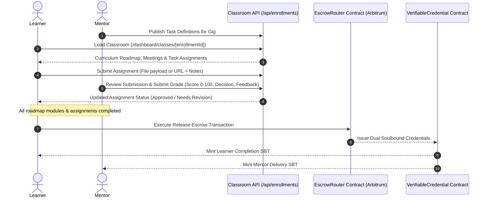
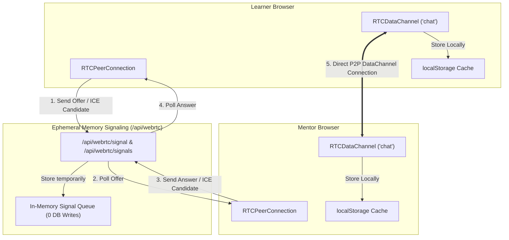

# TRUST LESSON — CLASSROOM WORKSPACE & WEBRTC P2P ARCHITECTURE
**Specification Version:** 2.1.0 • **Target Runtime:** Next.js 15 App Router • **Network:** Arbitrum Sepolia / One

---

## 1. Overview & System Objectives

The Trust Lesson Classroom & P2P Communication subsystem provides an end-to-end interactive workspace connecting learners and mentors directly inside their active gig contracts.

Key operational objectives:
1. **Interactive Gig Classroom**: Dedicated mentor management suite (`/dashboard/gigs/[gigId]`) and learner study hub (`/dashboard/classes/[enrollmentId]`).
2. **Assignment & Deliverables Engine**: Structured curriculum tasks supporting multi-format submissions (file uploads, Google Forms, GitHub links) with mentor grading, feedback, and scoring.
3. **Escrow Completion & Certification**: Native settlement triggers within the classroom interface, releasing milestone escrow funds and issuing dual-party Soulbound Token (SBT) completion credentials.
4. **WebRTC P2P Direct Chat**: Zero database storage footprint; peer-to-peer data channels for real-time messaging with lightweight in-memory signaling.
5. **Instant Rendering & Low-Latency UX**: Stale-while-revalidate caching via `sessionStorage`, layout skeleton shells, and batched database queries.

---

## 2. Classroom & Gig Management Flow



### 2.1 Mentor Gig Command Center (`/dashboard/gigs/[gigId]`)
- **Student Roster & Progression**: Mentors inspect all enrolled learners, track module completion percentages, and review meeting request logs.
- **Task Definition Creation**: Mentors create specific assignments tied to their curriculum with instructions, due dates, and minimum passing criteria.
- **Grading & Feedback Modal**: Instant evaluation interface allowing mentors to review submitted files/links, assign numeric scores (0-100), choose approval status (`APPROVED` or `REJECTED`), and return actionable advice.

### 2.2 Learner Classroom Hub (`/dashboard/classes/[enrollmentId]`)
- **Roadmap & Progress Sync**: Interactive roadmap where learners check off completed curriculum units, saved locally and synced with their enrollment state.
- **Meeting Scheduler Integration**: Real-time quota check (total vs remaining sessions) with one-click live session booking.
- **Deliverable Submission Form**: Drag-and-drop file upload engine or external link submission (Google Drive, Google Forms, GitHub repository) with custom notes.
- **Escrow Settlement Modal**: Direct trigger to complete the gig and release escrowed funds to the mentor, accompanied by an instant certificate modal displaying mentor and course details.

---

## 3. WebRTC P2P Direct Chat Architecture

To prevent database bloating and ensure low-latency communication, chat operates completely peer-to-peer using WebRTC DataChannels.



### 3.1 Signaling Protocol Specification
- **Offer / Answer / ICE Exchange**: Handled via transient in-memory queues keyed by `roomId` (scoped to `enrollmentId` or mentor-learner pairing).
- **Endpoint `POST /api/webrtc/signal`**:
  ```json
  {
    "roomId": "enrollment-uuid",
    "from": "0x1234...",
    "type": "offer | answer | candidate",
    "data": { ... }
  }
  ```
- **Endpoint `GET /api/webrtc/signals?roomId={id}&recipient={address}`**:
  Retrieves and drains pending signaling messages for the caller.
- **Zero Database Overhead**: No messages, timestamps, or text payloads ever hit the database server.

### 3.2 Client-Side DataChannel Management (`useWebRTCChat`)
- **Direct P2P DataChannel**: Once connected, messages travel directly between peers without server intermediary.
- **Local Persistence**: Messages are stored in client `localStorage` under `tl_webrtc_chat_{roomId}`.
- **Connection Health State**:
  - `disconnected`: Initial state or peer offline.
  - `signaling`: Negotiating SDP offer/answer exchange.
  - `connected`: Active peer-to-peer data channel ready.
  - `failed`: ICE connection failed or timed out.
- **Navbar Real-Time Alerting**: Global unread badge and incoming message toasts integrated into the top navigation bar.

---

## 4. Performance & Rendering Optimization Engine

To eliminate lag on heavy classroom and gig management pages, a multi-layer optimization pipeline is enforced:

### 4.1 0ms Instant Cache (Stale-While-Revalidate)
Upon mounting `/dashboard/classes/[enrollmentId]`:
1. The component immediately checks `sessionStorage` for `tl_classroom_cache_${enrollmentId}`.
2. If cached data exists, it renders the complete classroom UI in 0 milliseconds.
3. In the background, `fetchClassroom()` sends a revalidation request. Once updated data arrives, the state seamlessly updates without UI layout shift.

### 4.2 Progressive Skeleton Shell
- Replaced intrusive full-screen blocking modals ("Loading Classroom... Verifying escrow status...") with responsive animated skeleton components matching the exact proportions of breadcrumbs, header heroes, navigation tabs, and module cards.
- Allows partial and perceived instant rendering while network verification finalizes.

### 4.3 Database Query Batching & Parallelization
- **Batched Task Synchronization**: Instead of executing $N$ individual sequential `findFirst` and `create` operations for curriculum task definitions, the endpoint performs a single `findMany` lookup followed by a bulk `createMany({ skipDuplicates: true })`.
- **Concurrent Access Verification**: Replaced waterfall database queries in `lib/access.js` with `Promise.all` to query enrollment state, gig details, and user permissions concurrently.
- **Fast RPC Safeguards**: Lowered blockchain RPC verification timeouts with cached fallbacks to avoid blocking HTTP responses when public RPC nodes experience latency spikes.

---

## 5. Code Reliability & Syntax Automation

To safeguard production deployments and eliminate runtime parse regressions:
- **SWC Syntax Checker (`scripts/lint-check.js`)**: An automated validation script that parses every JavaScript and JSX file using `@swc/core` with ECMAScript syntax and JSX support.
- **Execution Script**:
  ```bash
  npm run lint:check
  ```
- **Coverage**: All files across `app/`, `src/`, and `lib/` are verified before release, guaranteeing 100% syntactical integrity.
