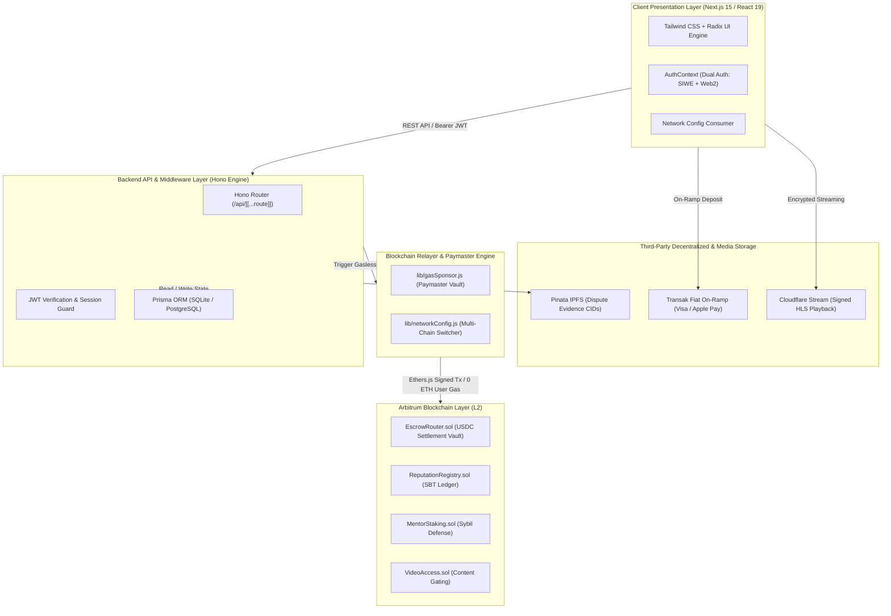
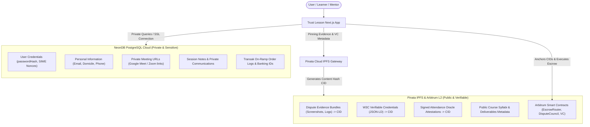
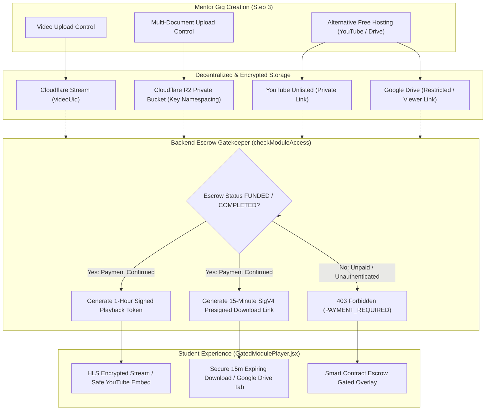

# TRUST LESSON — CODE ARCHITECTURE & TECHNICAL BLUEPRINT
**Version:** 2.0.0 • **Network:** Arbitrum Sepolia / Arbitrum One • **Framework:** Next.js 15 App Router

---

## 1. ARCHITECTURAL PHILOSOPHY & SYSTEM OVERVIEW

Trust Lesson is engineered as a **hybrid Web2 / Web3 decentralized education and mentorship protocol**. It eliminates the traditional onboarding friction of Web3 (gas fees, complex wallet popups, native token management) while maintaining the trustless guarantees of blockchain technology (cryptographic escrow, non-custodial settlements, tamper-proof Soulbound credentials).



---

## 2. DIRECTORY & CODEBASE ORGANIZATION

```text
Trust Learn/
├── app/                              # Next.js 15 App Router & API Handlers
│   ├── api/[[...route]]/route.js     # Unified Hono API Router (Auth, Sessions, Escrow, Leaderboard)
│   ├── about/page.jsx                # Platform vision, protocol mechanics & team profiles
│   ├── book/[type]/[id]/page.jsx     # Booking engine, escrow locking & payment gateway
│   ├── certificate/[id]/page.jsx     # 2-Page landscape diploma & light academic transcript (3D Flip)
│   ├── dashboard/page.jsx            # Role-aware control center (Learner, Mentor, Admin)
│   ├── explore/page.jsx              # Searchable marketplace for mentors and courses
│   ├── leaderboard/page.jsx          # Live on-chain rankings, spotlight podium, & Dispute Juror pool
│   ├── layout.jsx                    # Root HTML layout, font injection & AuthProvider
│   └── page.jsx                      # Homepage with live platform metrics & featured courses
├── contracts/                        # Solidity 0.8.20 Smart Contracts
│   ├── EscrowRouter.sol              # Milestone escrow vault (10% protocol fee), fee split & disputes
│   ├── DisputeCouncil.sol            # 3-of-5 multi-sig dispute council & Kleros escalation hook
│   ├── VerifiableCredential.sol      # Composite dual-party W3C JSON-LD & EIP-712 Soulbound credentials
│   ├── SkillGraph.sol                # On-chain skill dependency DAG & prerequisite level gating
│   ├── MentorStaking.sol             # Mentor economic stake pool ($100 min) & slashing engine
│   └── VideoAccess.sol               # On-chain course content access gating
├── docs/                             # Engineering & Protocol Documentation
│   ├── code architecture.md          # Technical blueprint & architecture specifications
│   ├── report.md                     # Comprehensive platform audit & technical validation report
│   ├── dispute-architecture.md       # DisputeCouncil 3-of-5 multi-sig & juror game theory
│   ├── credential-v2-spec.md         # W3C Verifiable Credentials & SkillGraph specification
│   └── systematics.md                # System workflow, state machine & lifecycle systematics
├── lib/                              # Core Utilities & Protocol Runtime Engines
│   ├── networkConfig.js              # Centralized Multi-Chain Switcher (Testnet / Mainnet)
│   ├── gasSponsor.js                 # Paymaster relayer & gas subsidy attestation engine
│   ├── smartWallet.js                # ERC-4337 Account Abstraction smart account engine
│   ├── credentialSigner.js           # EIP-712 typed credential hashing & off-chain signing
│   ├── attendanceOracle.js           # Cryptographic attendance verifier for 1-on-1 sessions
│   ├── auth.js                       # Password hashing & cryptographic utilities
│   ├── jwt.js                        # Stateless jose JWT signer & bearer verifier
│   ├── prisma.js                     # Singleton Prisma NeonDB PostgreSQL connection pooler
│   ├── cloudflare.js                 # Cloudflare Stream signed upload & tokenized playback
│   ├── cloudflareR2.js               # Cloudflare R2 private vault upload & AWS SigV4 presigned URLs
│   └── ipfs.js                       # Pinata IPFS payload upload & CID derivation
├── prisma/                           # Relational Database Model
│   └── schema.prisma                 # Schema definitions (Users, Sessions, Milestones, Videos, AuthNonce)
├── scripts/                          # Automation & Deployment Scripts
│   ├── deployV2.cjs                  # Complete V2 smart contracts deployment & wiring script
│   ├── seedLeaderboard.js            # NeonDB database seeder for live verified leaderboard
│   ├── convertToWebp.js              # Automated WebP asset optimization pipeline
│   ├── deploy.cjs                    # Hardhat multi-chain contract deployment script
│   └── createUsers.js                # Seed mock user data for development
├── services/                         # Background Daemons
│   ├── indexer.js                    # Viem Arbitrum L2 event listener & database sync
│   └── websocket.js                  # Real-time WebSocket server for escrow state updates
├── src/                              # Client Frontend Support Assets
│   ├── components/                   # Navbar, Footer, CurrencyBadge, UI primitives
│   │   ├── GatedModulePlayer.jsx     # Render-time escrow token verification, player & R2 downloads
│   │   ├── PlatformIcons.jsx         # Pure SVG vector brand icons (YouTube, Google Drive)
│   │   └── WalletIcons.jsx           # Clean SVG wallet icons (MetaMask, Rabby, Coinbase)
│   ├── context/AuthContext.jsx       # Global authentication state, SIWE handler & user role
│   ├── data/mentors.js               # Initial curated mentor roster
│   └── db/localDb.js                 # Client-side fallback storage engine
├── .env                              # Active environment configuration (GIT-IGNORED)
├── .env.local.example                # Safe clean template for contributors
├── .gitignore                        # Git exclusion rules (.env, report.md, build outputs)
├── hardhat.config.cjs                # Hardhat L2 network configuration & compiler settings
└── package.json                      # Dependency manifests & NPM task runners
```

---

## 3. FRONTEND ARCHITECTURE (REACT 19 & NEXT.JS 15 APP ROUTER)

### 3.1 Client / Server Separation
The application leverages Next.js 15 App Router. Pages requiring rich browser-side reactivity (Web3 wallet connections, transaction monitoring, dynamic countdowns, video playback) use the `"use client"` directive, while layouts and static components render server-side for maximum SEO and low Time-To-Interactive (TTI).

### 3.2 Dual Authentication Pattern (`src/context/AuthContext.jsx`)
Trust Lesson supports both Web3 natives and Web2 mainstream users through a unified context:
1. **Web3 Authentication (EIP-4361 SIWE):**
   - Learner/Mentor connects MetaMask, Coinbase Wallet, or Rabby.
   - Client requests a cryptographically randomized nonce from `/api/auth/nonce`.
   - User signs the personal sign message: `Trust Lesson Login\nAddress: <address>\nNonce: <nonce>`.
   - Backend verifies signature and issues an HMAC-SHA256 JWT stored in `localStorage` (`tl_jwt`) and HTTP cookie (`tl_session`).
2. **Web2 Email & Password Authentication:**
   - Mentors or learners can register with traditional email/password credentials.
   - Passwords are encrypted with PBKDF2 salt-derived hashes.
   - An identical JWT payload structure is issued, ensuring uniform API permissions.

---

## 4. BACKEND API ARCHITECTURE (HONO ON NEXT.JS RUNTIME)

All backend endpoints are consolidated into an edge-compatible **Hono router** mounted at `app/api/[[...route]]/route.js`.

### 4.1 Route Segments & Endpoints

| Category | Endpoint | Method | Authentication | Purpose |
| :--- | :--- | :--- | :--- | :--- |
| **Auth** | `/api/auth/nonce` | `POST` | Public | Generates cryptographic nonce for SIWE |
| **Auth** | `/api/auth/verify` | `POST` | Public | Validates wallet signature, returns JWT |
| **Auth** | `/api/auth/login` | `POST` | Public | Authenticates email/password credentials |
| **Auth** | `/api/auth/me` | `GET` | Bearer JWT | Retrieves active authenticated user session |
| **Escrow** | `/api/sessions` | `POST` | Bearer JWT | Creates new escrow session & returns calldata |
| **Escrow** | `/api/sessions/:id/confirm-tx` | `POST` | Bearer JWT | Records on-chain deposit transaction hash |
| **Escrow** | `/api/sessions/:id/milestones/:idx/confirm` | `POST` | Bearer JWT | Releases milestone payout to mentor |
| **Escrow** | `/api/sessions/:id/dispute` | `POST` | Bearer JWT | Freezes escrow & pins evidence to IPFS |
| **Video** | `/api/videos/upload-url` | `POST` | Mentor JWT | Generates Cloudflare Stream direct upload URL |
| **Video** | `/api/videos/:id/stream` | `GET` | Bearer JWT | Checks on-chain entitlement & signs HLS token |
| **Reputation** | `/api/reputation/:address` | `GET` | Public | Computes mentor average rating & SBT count |
| **Relayer** | `/api/relayer/sponsor-status`| `GET` | Public | Returns gas paymaster balance & subsidization stats |
| **Admin** | `/api/admin/stats` | `GET` | Admin JWT | Aggregates volume, escrow locks & dispute count |

---

## 5. MULTI-CHAIN NETWORK SWITCHER ARCHITECTURE (`lib/networkConfig.js`)

To guarantee zero human error during testnet-to-mainnet protocol migrations, Trust Lesson centralizes all blockchain infrastructure parameters into a single master switcher module:

```javascript
// Active network is governed by ONE variable in .env:
// NEXT_PUBLIC_APP_NETWORK="testnet" | "mainnet" | "local"
import { getActiveNetwork, getExplorerTxUrl } from "@/lib/networkConfig";

const net = getActiveNetwork();
console.log(net.name);        // "Arbitrum Sepolia"
console.log(net.chainId);     // 421614
console.log(net.rpcUrl);      // "https://sepolia-rollup.arbitrum.io/rpc"
console.log(net.contracts);   // All deployed contract addresses
```

### 5.1 Environment Configuration Matrix

| Parameter | Testnet (`testnet`) | Mainnet (`mainnet`) | Localhost (`local`) |
| :--- | :--- | :--- | :--- |
| **Network Name** | Arbitrum Sepolia | Arbitrum One | Hardhat Localhost |
| **Chain ID** | `421614` (`0x66eee`) | `42161` (`0xa4b1`) | `31337` (`0x7a69`) |
| **Public RPC** | `https://sepolia-rollup.arbitrum.io/rpc` | `https://arb1.arbitrum.io/rpc` | `http://127.0.0.1:8545` |
| **Block Explorer**| `https://sepolia.arbiscan.io` | `https://arbiscan.io` | `http://localhost:8545` |
| **USDC Contract** | `0x75faf114eafb1BDbe2F0316DF893fd58CE46AA4d` | `0xaf88d065e77c8cC2239327C5EDb3A432268e5831` | Mock ERC-20 |
| **EscrowRouter** | `0x14BBB05C74fBcD2E122E197FD244b54dFb171587` | Mainnet Vault | Local Genesis Vault |
| **Reputation** | `0xE04Ca75db5020D3F2C48b0a921CB93419BE53A0E` | Mainnet SBT Ledger | Local SBT Ledger |
| **MentorStaking**| `0x6d34056576d76835CC3e0bB8F372C2EB4A7D324b` | Mainnet Staking | Local Staking |
| **VideoAccess** | `0x6E87B4D073f36624111267ba498705E194C28763` | Mainnet DRM Access | Local DRM Access |
| **Transak Mode** | `STAGING` | `PRODUCTION` | `STAGING` |

---

## 6. SMART CONTRACT ARCHITECTURE (ARBITRUM L2 LAYER)

All contracts are written in Solidity `^0.8.20` and inherit OpenZeppelin 5.x primitives (`ReentrancyGuard`, `Ownable`).

```mermaid
classDiagram
    class EscrowRouter {
        +IERC20 usdc
        +uint256 nextSessionId
        +mapping(uint256 => Session) sessions
        +address arbiter
        +uint256 accumulatedFees
        +createSession(address mentor, uint256[] amounts) uint256
        +startSession(uint256 sessionId)
        +confirmMilestone(uint256 sessionId, uint256 index)
        +raiseDispute(uint256 sessionId, bytes32 evidenceHash)
        +resolveDispute(uint256 sessionId, uint8 releasePercent)
        +cancelSession(uint256 sessionId)
        +withdrawFees(address to)
    }

    class ReputationRegistry {
        +uint256 nextCredentialId
        +mapping(uint256 => Credential) credentials
        +address escrowRouter
        +issueCredential(address mentor, address learner, uint256 sessionId, uint8 rating, string skillTag) uint256
        +getMentorRating(address mentor) (uint256, uint256)
        +getMentorCredentials(address mentor) uint256[]
    }

    class MentorStaking {
        +IERC20 usdc
        +uint256 MIN_STAKE (100 USDC - PRO)
        +uint256 MASTER_STAKE (300 USDC - MASTER)
        +uint256 UNSTAKE_DELAY (7 days)
        +enum Tier { NONE, PRO, MASTER }
        +address escrowRouter
        +stake(uint256 amount)
        +requestUnstake()
        +unstake()
        +slash(address mentor, uint256 amount, address recipient)
        +isVerified(address mentor) bool
        +getTier(address mentor) Tier
        +getStakeAmount(address mentor) uint256
    }

    class VideoAccess {
        +IERC20 usdc
        +mapping(uint256 => Video) videos
        +mapping(address => mapping(uint256 => bool)) accessMap
        +registerVideo(bytes32 contentHash, uint256 priceUsdc) uint256
        +purchaseAccess(uint256 videoId)
        +hasAccess(address learner, uint256 videoId) bool
    }

    EscrowRouter ..> ReputationRegistry : Calls issueCredential on session completion
    EscrowRouter ..> MentorStaking : Calls slash() when mentor loses dispute
```

### 6.1 Security Invariants
- **Checks-Effects-Interactions (CEI):** Internal balances, milestone release flags, and session states are updated *before* invoking external ERC-20 transfers.
- **Reentrancy Protection:** All fund-moving methods (`createSession`, `confirmMilestone`, `resolveDispute`, `cancelSession`, `withdrawFees`) utilize `nonReentrant`.
- **Soulbound Immutability:** Credentials inside `ReputationRegistry` have no `transfer()` or `approve()` functions, preventing credentials from being bought or sold.

### 6.2 Economic & Protocol Cut Invariant
- **10% Platform Protocol Cut (`PLATFORM_FEE_BPS = 1000`):** Enforced natively on-chain in `contracts/EscrowRouter.sol`. For any subtotal $S$, the fee is computed as `(S * PLATFORM_FEE_BPS) / BPS_DENOMINATOR`. The total deposit pulled from the learner is $S + \text{fee}$, guaranteeing that the mentor receives 100% of their listed base price upon milestone release, while platform operations are sustainably funded.

---

## 7. PLATFORM GAS SUBSIDY & PAYMASTER RELAYER (`lib/gasSponsor.js`)

Trust Lesson utilizes a dedicated **Platform Gas Subsidy Engine**:
1. When a session is completed, instead of forcing the student or mentor to submit a MetaMask transaction and burn ETH, the backend relayer signs the transaction using the server-side `PLATFORM_SPONSOR_PRIVATE_KEY`.
2. The user sees: **"Network Fee: Sponsored ($0.00 Charged)"**.
3. The platform sponsor vault (`0xf2cE53...`) absorbs the transaction gas cost on Arbitrum L2 (typically `< $0.001` per transaction due to Arbitrum Nitro calldata compression).
4. **Strict Cryptographic Honesty:** In staging mode without live funded keys, the engine explicitly outputs `onChain: false`, `status: "STAGING_PREVIEW"`, avoiding any deceptive or fabricated transaction hashes.

---

## 8. SUMMARY MATRIX

| Layer | Primary Technology | Key File | Responsibility |
| :--- | :--- | :--- | :--- |
| **Client UI** | Next.js 15, Tailwind, Radix | `app/book/[type]/[id]/page.jsx` | User booking & wallet interaction |
| **State Sync** | React Context, Ethers.js | `src/context/AuthContext.jsx` | SIWE authentication & user session |
| **API Router** | Hono Framework | `app/api/[[...route]]/route.js` | REST endpoints & session validation |
| **Multi-Chain** | Custom Switcher Engine | `lib/networkConfig.js` | Environment switching (Testnet/Mainnet)|
| **Gas Paymaster**| Ethers.js Relayer | `lib/gasSponsor.js` | Subsidized gas sponsorship & attestation |
| **Smart Vault** | Solidity 0.8.20 (Arbitrum) | `contracts/EscrowRouter.sol` | Non-custodial escrow & fee division |
| **Reputation** | Solidity SBT Ledger (V2 VC) | `contracts/VerifiableCredential.sol` | Composable W3C credentials & EIP-712 |
| **Dispute Council**| 3-of-5 Juror Multi-Sig | `contracts/DisputeCouncil.sol` | Decentralized arbitration & evidence audit |
| **Database** | Prisma ORM & NeonDB PostgreSQL | `prisma/schema.prisma` | Relational private persistence & fast reads |
| **Decentralized Storage** | Pinata IPFS (CIDs) | `lib/ipfs.js` | Public dispute evidence & VC JSON-LD metadata |

---

## 9. HYBRID PRIVACY ARCHITECTURE (NeonDB Cloud + Pinata IPFS)

Trust Lesson enforces a strict separation between **Sensitive Operational Privacy** and **Verifiable Decentralized Public Data**:



### Data Placement Matrix:

| Category | Storage Target | Privacy Level | Rationale |
| :--- | :--- | :--- | :--- |
| **Password Hashes & Auth Nonces** | NeonDB PostgreSQL | 🔒 Strictly Private | Cannot be public on IPFS or blockchain; protected behind database encryption and SSL. |
| **Meeting Invites & Passcodes** | NeonDB PostgreSQL | 🔒 Strictly Private | Prevents unauthorized intrusion into live 1-on-1 mentor sessions. |
| **Personal Notes & Chat Logs** | NeonDB PostgreSQL | 🔒 Strictly Private | Learner-mentor personal discussions protected by privacy laws. |
| **Dispute Evidence Bundles** | Pinata IPFS (`lib/ipfs.js`) | 🌐 Publicly Verifiable | Jurors in `DisputeCouncil.sol` and the community need decentralized, immutable access to audit evidence. |
| **W3C Verifiable Credentials** | Pinata IPFS (`lib/ipfs.js`) | 🌐 Composable & Portable | External job boards, DAOs, and dApps can read credential metadata via `ipfs://<CID>` without trusting a centralized DB. |
| **Attendance Oracle Attestations**| Pinata IPFS & L2 | 🌐 Verifiable Proof | Cryptographic attendance receipts signed by platform relayer for transparent proof-of-completion. |
| **Escrow & Staking Balances** | Arbitrum Sepolia / One | 🌐 On-Chain Immutable | Handled by `EscrowRouter.sol` & `MentorStaking.sol` for trustless settlement. |

---

## 10. AUTOMATED ASSET OPTIMIZATION PIPELINE (`scripts/convertToWebp.js`)

To optimize mobile performance and reduce bandwidth consumption across media-rich interfaces, Trust Lesson integrates an automated WebP conversion engine:
- **Engine Script:** `scripts/convertToWebp.js` (powered by Node.js and Sharp image compression).
- **Compression Efficiency:** Reduces raw PNG/JPEG asset sizes by up to 75% without perceptible fidelity degradation.
- **Panoramic Assets:** Produces high-efficiency assets such as `public/leaderboard.webp` (hero banner) and modern WebP team portraits, ensuring instantaneous Core Web Vitals (LCP < 1.2s) even on high-latency mobile networks.

---

## 11. ON-CHAIN PROTOCOL LEADERBOARD & JUROR SORTITION ARCHITECTURE

The Trust Lesson Leaderboard (`app/leaderboard/page.jsx`, `/api/leaderboard`) serves as both a public recognition engine and the **eligibility pool for decentralized dispute governance**.

```mermaid
flowchart LR
    subgraph Storage ["NeonDB Cloud PostgreSQL"]
        Users["User Table (Mentors & Learners)"]
        Sessions["Session Table (Completed Milestones)"]
        Certs["Certificate Table (Verified SBTs)"]
    end

    subgraph API ["Hono Route /api/leaderboard"]
        QueryEngine["Data Aggregation Engine"]
        ScoringAlgo["Weighted Scoring Calculator"]
        JurorFilter["Juror Eligibility Sortition Filter"]
    end

    subgraph Client ["Leaderboard Frontend (app/leaderboard/page.jsx)"]
        Hero["Panoramic Hero Banner (leaderboard.webp)"]
        Podium["Spotlight Podium (Top 3 Ranks)"]
        Table["Rankings Table + Juror Badges"]
        Pagination["Thematic Web3 Page Controls"]
        Governance["Dispute Governance Showcase Card"]
    end

    Storage --> QueryEngine
    QueryEngine --> ScoringAlgo
    ScoringAlgo --> JurorFilter
    JurorFilter --> Client
```



### 11.1 Dynamic Scoring Algorithm (Opsi B Capped Collateral Model)
Rankings are calculated dynamically from on-chain-verified database records using merit-based formulas where economic stake cannot buy placement:
- **Mentor Score Formula:**
  $$\text{stakeBonus} = \min(\text{stakeAmount}, 250) \times 0.1 \quad (\text{Capped at max } 25\text{ pts})$$
  $$\text{Score}_{\text{Mentor}} = \text{stakeBonus} + (\text{sessionsCount} \times 25) + (\text{rating} \times 20)$$
  *(Untuk mentor baru dengan 0 sesi selesai, rating berstatus `null` dan skor rating bernilai 0, menampilkan badge `New` alih-alih rating default).*
  *Rationale:* Reputasi dan peringkat murni didapatkan dari pengajaran aktif dan kepuasan siswa; modal stake berfungsi sebagai agunan keamanan (*collateral tier*) dengan kontribusi skor berbatas atas (*capped*).
- **Student / Learner Score Formula:**
  $$\text{Score}_{\text{Student}} = \text{sessionsCount} \times 80$$
  *Rationale:* Meleburkan metrik sesi dan kredensial SBT ke satu formula linier karena setiap 1 sesi selesai menerbitkan tepat 1 composite Soulbound credential, mengeliminasi risiko *double-counting*.

### 11.2 Dispute Council Juror Pool & Dynamic On-Chain Sortition
- **Juror Eligibility Criteria:**
  1. Stake $\ge 100$ USDC di `MentorStaking.sol`
  2. Sesi mengajar selesai $\ge 5$ sesi
  3. Rata-rata rating siswa $\ge 4.8 / 5.0$
- **Badge Representation:** Hanya mentor yang memenuhi seluruh kriteria di atas yang mendapatkan badge emerald **"Council Juror Eligible"**. Mentor dengan 0 sesi atau stake kurang menampilkan status transparan (e.g. `Need 5+ Sessions` atau `Need $100 Stake`).
- **Dynamic Sortition Engine:** `DisputeCouncil.sol` menarik kandidat juri secara acak dari `jurorPool` menggunakan entropi blok (`block.prevrandao`, `block.timestamp`, `caseId`), dilengkapi **Conflict-of-Interest Filter** on-chain yang secara ketat mendiskualifikasi murid dan mentor yang bersengketa dari panel 5 juri kasus tersebut.

### 11.3 UI/UX Design & Thematic Web3 Components
- **Panoramic Hero Banner:** Utilizes the vibrant `public/leaderboard.webp` banner with high-contrast dark drop-shadow typography (`text-shadow: 0 2px 10px rgba(0,0,0,0.7)`) for pristine readability on mobile and desktop without artificial darkening overlays.
- **Top 3 Spotlight Podium:** Distinct visual podium highlighting Gold (#1), Silver (#2), and Bronze (#3) leaders with animated glowing accents.
- **Thematic Web3 Pagination:** Custom styled buttons (`< Previous`, numbered active indicators, `Next >`) with live database connection pills indicating NeonDB PostgreSQL sync state.
- **Animated Loading State:** Sleek dual-ring cyan/indigo spinner with pulse skeleton loaders replacing raw text notifications during data hydration.

---

## 12. 2-PAGE LANDSCAPE VERIFIABLE CERTIFICATE & DYNAMIC 3D CARD FLIP MECHANICS

The certificate verification route (`app/certificate/[id]/page.jsx`) implements an institutional-grade, verifiable 2-page credential with interactive 3D rotation and print fidelity.

```mermaid
stateDiagram-v2
    direction LR
    [*] --> FrontFace: Initial Render
    FrontFace --> BackFace: User Clicks "Flip to View Transcript"
    BackFace --> FrontFace: User Clicks "Flip to Front Diploma"
    
    state FrontFace {
        DiplomaTitle: Conferred Academic Diploma
        Recipient: Recipient Name & Wallet Address
        EASSeal: EAS Attestation Seal & Credential ID
        Signatures: Mentor & Protocol Lead Signatures
        GasBadge: 100% Gas Subsidized Badge
    }
    
    state BackFace {
        TranscriptHeader: Official Academic Transcript
        Milestone1: M1 - Threat Modeling & Reentrancy Analysis
        Milestone2: M2 - Formal Invariant Fuzzing & Slashing
        Milestone3: M3 - Arbitrum Gas Optimization & Settlement
        IPFSRecord: Decentralized IPFS Metadata CID
        EIP712Digest: EIP-712 Soulbound Verification Hash
    }
```



### 12.1 Dynamic CSS Document Flow (Anti-Clipping Solution)
In conventional CSS 3D card flip implementations, both faces are assigned `position: absolute; height: 100%`, causing the taller back face (containing detailed milestone rubrics and transcript breakdowns) to be abruptly clipped by the parent container's fixed height.

Trust Lesson solves this via **Dynamic CSS Document Flow Activation**:
```css
/* Card container preserves 3D perspective */
.cert-card-inner {
  position: relative;
  width: 100%;
  transition: transform 0.7s cubic-bezier(0.4, 0.2, 0.2, 1);
  transform-style: preserve-3d;
}

/* When flipped, back face transitions to relative flow */
.cert-card-inner.flipped .cert-face-back {
  position: relative;
  min-height: 100%;
  transform: rotateY(0deg); /* Rendered in normal viewport flow */
}

/* Front face is hidden when rotated */
.cert-card-inner.flipped .cert-face-front {
  position: absolute;
  top: 0;
  left: 0;
  width: 100%;
  height: 100%;
  pointer-events: none;
}
```
*Result:* The outer card dynamically expands to fit all milestone audit details, cryptographic proof hashes, and transcript criteria without vertical truncation, scrollbars, or layout clipping.

### 12.2 Academic Transcript Rubric & Audited Milestones
The back face renders a rigorous 3-tier milestone audit breakdown:
1. **Milestone 1 — Architecture & Threat Analysis:** Formal review of system state transitions, CEI compliance, and reentrancy attack vectors.
2. **Milestone 2 — Invariant Fuzzing & Slashing:** Comprehensive fuzz test coverage and economic penalty execution in `MentorStaking.sol`.
3. **Milestone 3 — Gas Optimization & Settlement:** Nitro calldata compression, EscrowRouter payout authorization, and dual-party attestation.

### 12.3 2-Page Landscape Print & Export Engine
- **Print Optimization:** Enforces horizontal landscape output (`@page { size: landscape; margin: 0; }`) with `page-break-after: always;` ensuring Page 1 (Formal Diploma) and Page 2 (Academic Transcript) print seamlessly as two distinct physical pages.
- **Export Standards:** Includes direct downloads for W3C JSON-LD portable credentials, one-click PDF printing, and live verification links pointing directly to the Arbitrum Sepolia explorer (`https://sepolia.arbiscan.io/tx/...`).

---

## 13. NATIVE ACCESS-GATED CURRICULUM UPLOADS & DUAL-TIER STORAGE ARCHITECTURE

Trust Lesson prevents content piracy and intellectual property leakage by replacing arbitrary URL inputs with a verified **Access-Gating Pipeline**:



### 13.1 Gated Endpoints Specification
1. **`POST /api/modules/upload-video`**:
   - Accepts multipart file streaming from authenticated mentors.
   - Uploads to Cloudflare Stream and persists only the private `videoUid` (never exposing public playback URLs).
2. **`GET /api/modules/:id/playback-token`**:
   - Enforces strict milestone escrow gating (`FUNDED`, `IN_SESSION`, or `COMPLETED` on-chain / indexed database).
   - Generates a short-lived **1-hour signed playback token** (`expiresIn: 3600`).
   - Returns **403 Forbidden** if the learner has not funded the milestone escrow.
3. **`POST /api/modules/upload-resource`**:
   - Accepts document files (`.pdf`, `.pptx`, `.docx`, `.zip`) and streams them into a private Cloudflare R2 bucket.
   - Namespaces keys by module: `modules/{moduleId}/{uuid}-{filename}`.
4. **`GET /api/modules/:id/resources/:resourceId/download`**:
   - Validates learner payment authorization.
   - Generates short-lived **15-minute AWS SigV4 presigned GET URLs** (`expiresIn: 900`).
   - Automatically rejects expired or tampered download tokens.

### 13.2 Dual-Tier Hosting Strategy (Enterprise vs Zero-Cost Free Tier)
To accommodate mentors regardless of infrastructure budget, the creation form supports a dual-tier storage selector:
- **Tier 1 (Enterprise Encrypted):** Cloudflare Stream + Cloudflare R2 with automatic signed-token gating.
- **Tier 2 (Zero-Cost Alternative):** Unlisted YouTube Video links + Restricted Google Drive links, accompanied by an interactive in-app guide explaining how to set proper privacy settings so content remains exclusive to enrolled students.
- **Isolated Practice Repositories:** Separate, optional plain-text `GitHub URL` input strictly scoped for open-source starter repos, keeping proprietary PDFs and source slides securely behind escrow gates.

---

## 14. GIG CLASSROOM, ASSIGNMENTS & WEBRTC P2P ENGINE

For in-depth technical specifications, refer to [Classroom & WebRTC Architecture](./classroom-webrtc-architecture.md).

### 14.1 Key Capabilities
1. **Interactive Gig Classroom Hub (`/dashboard/gigs/[gigId]` & `/dashboard/classes/[enrollmentId]`)**:
   - Mentors monitor student progress, review live session requests, and issue assignments.
   - Learners navigate curriculum roadmaps, schedule sessions, and submit deliverables.
2. **Assignment & Deliverables Engine**:
   - Supports file uploads (PDF, text, documents) and external resource links (Google Forms, Google Docs, GitHub repos).
   - Mentors score submissions (0-100), assign approval decisions (`APPROVED`, `REJECTED`), and provide targeted feedback.
3. **Native Escrow Settlement & Certification**:
   - Direct escrow release from the classroom interface.
   - Dual-party Soulbound Token (SBT) minting upon gig completion.
4. **WebRTC P2P Direct Chat (Zero Database Overhead)**:
   - Direct peer-to-peer messaging via WebRTC DataChannels (`RTCDataChannel`).
   - Ephemeral in-memory signaling (`/api/webrtc/signal`, `/api/webrtc/signals`) with zero database storage footprint.
   - Local chat persistence via `localStorage` and real-time P2P status badges.
5. **Instant Rendering & Low Latency**:
   - 0ms initial render via `sessionStorage` stale-while-revalidate caching.
   - Layout skeleton shell replacing full-screen blocking modals.
   - Batched Prisma queries with `createMany` and concurrent DB lookups using `Promise.all`.
6. **Code Reliability Automation**:
   - Automated SWC syntax validator (`npm run lint:check` via `scripts/lint-check.js`) ensuring 100% build reliability across all codebase files.


