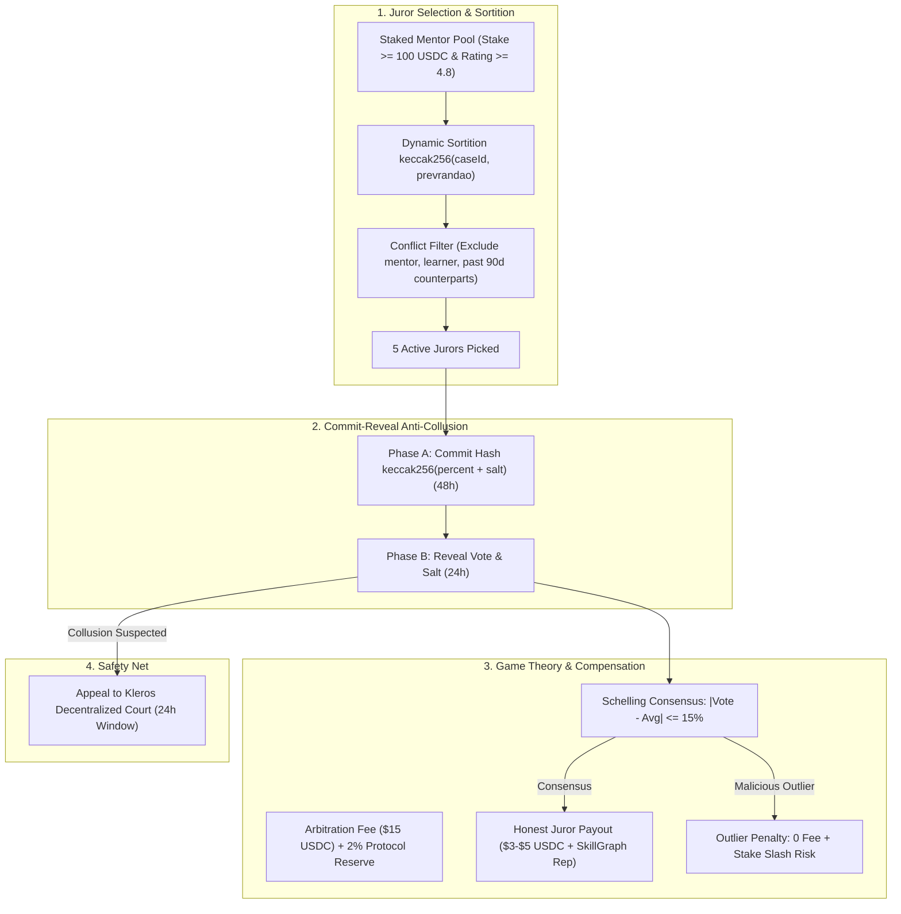

# Trust Lesson — Dispute Resolution Architecture

> **Version**: 1.5 | **Status**: Implementation | **Date**: 2026-09

## Phase Evolution

```
Phase 1.0 → Phase 1.5 → Phase 2.0 → Phase 3.0
  Single      3-of-5     Kleros      Full DAO
  Arbiter     Council    Escalation  Governance
```

## Current: Phase 1.5 — DisputeCouncil (On-Chain Dynamic Sortition)

**Live Contract (Arbitrum Sepolia):** [`0xAEA0b1E4238b5a9E6c0614b32b65e94D26F4B006`](https://sepolia.arbiscan.io/address/0xAEA0b1E4238b5a9E6c0614b32b65e94D26F4B006)  
**Parent EscrowRouter:** [`0x094E4b351272fA45613D7D093B7f3a3C20AeE795`](https://sepolia.arbiscan.io/address/0x094E4b351272fA45613D7D093B7f3a3C20AeE795)

### Architecture

```
Learner/Mentor raises dispute
         │
         ▼
   EscrowRouter.raiseDispute()
   → Session status: DISPUTED
         │
         ▼
   DisputeCouncil.openCase()
   → Dynamic on-chain sortition draws 5 distinct jurors from JurorPool
   → Conflict Filter automatically disqualifies learner & mentor
   → Evidence IPFS CID stored publicly
   → 72-hour resolution window starts
         │
    ┌────┴────┐
    │         │
    ▼         ▼
3+ Jurors  Timeout (72h)
Vote       → Auto 50/50
    │         │
    └────┬────┘
         │
         ▼
  EscrowRouter.resolveDispute(releasePercent)
  → Funds distributed to mentor/learner
         │
    24h appeal window
         │
    Phase 2.0: Kleros escalation
```

### Parameters

| Parameter | Value | Rationale |
|-----------|-------|----------|
| Juror Pool | Staked Mentors | Requires $\ge 100$ USDC locked in `MentorStaking.sol` |
| Sortition Method | On-Chain Dynamic Sortition | Pseudo-random Fisher-Yates draw via `block.prevrandao` & entropy |
| Conflict Filter | Algorithmic Exclusion | Disputed session learner & mentor cannot be drawn |
| Drawn Juror count | 5 | Odd number prevents ties with 3-of-5 quorum |
| Quorum required | 3 | 60% of drawn council panel |
| Resolution window | 72 hours | Enough for jurors across timezones |
| Appeal window | 24 hours | Quick escalation path |
| Auto-resolution | 50/50 split | Fair default when council fails to reach quorum |

### Evidence Transparency

All dispute evidence is stored on IPFS with the CID recorded **publicly** on-chain in `DisputeCase.evidenceIpfsCid`. Anyone can:

```bash
ipfs get <evidenceIpfsCid>
# Returns: JSON with reason, evidence, session details
```

This enables **public accountability** — any community member can verify the evidence and evaluate whether the DisputeCouncil voted correctly.

### Resolution Formula

```
finalReleasePercent = floor(sum(jurorVotes) / totalVotes)

Example:
  Juror 1 votes: 80% to mentor
  Juror 2 votes: 70% to mentor
  Juror 3 votes: 60% to mentor

  Final: floor((80+70+60)/3) = floor(70) = 70% to mentor
  Mentor receives: 70% of escrow (minus platform fee)
  Learner receives: 30% of escrow (minus platform fee)
```

### Juror Accountability & Governance Mechanics

---

## 4. JUROR GOVERNANCE, INCENTIVES & ANTI-COLLUSION SPECIFICATION

> [!IMPORTANT]
> This section formally addresses the four core governance questions scrutinized by Web3 auditors and hackathon judges: **Selection**, **Incentives**, **Anti-Collusion**, and **Compensation**.



---

### Q1: Siapa yang Select 5 Jurors? (Juror Selection & Eligibility)

Jurors are **NOT** arbitrary platform team wallets. They are dynamically drawn from an on-chain, reputation-staked pool:

1. **Eligibility Criteria (Proof of Competence & Stake):**
   - **Economic Stake**: Must have $\ge 100$ USDC locked in `MentorStaking.sol`.
   - **Proven Track Record**: Completed $\ge 5$ sessions on Trust Lesson with average rating $\ge 4.8 / 5.0$.
   - **Domain Competence**: Must hold at least **Level 2** in the relevant skill node in `SkillGraph.sol` (e.g. a Solidity dispute is only arbitrated by mentors with verified Solidity credentials).
   - **Clean Dispute Record**: Zero lost disputes in the past 180 days.

2. **Dynamic Pseudo-Random Sortition (Per-Case Selection):**
   - For every opened dispute, 5 distinct jurors are pseudo-randomly selected from the eligible pool using block entropy:
     $$\text{JurorSeed} = \text{keccak256}(\text{caseId}, \text{block.prevrandao}, \text{block.timestamp})$$
   - **Algorithmic Disqualification (Conflict of Interest)**:
     - The learner and mentor involved in the dispute are automatically blacklisted.
     - Any mentor who has conducted a paid session with either party in the last 90 days is disqualified.

3. **Phase 2.0 Progression (Decentralized TCR & Chainlink VRF):**
   - Integration with Chainlink VRF for provably fair juror selection.
   - Community Token-Curated Registry (TCR) where token holders can vote to admit or remove jurors from the master pool.

---

### Q2: Apa Incentive Juror untuk Vote Honestly? (Game Theory & Schelling Point)

Trust Lesson implements a **Schelling Point Consensus Mechanism** adapted from Vitalik Buterin's subjective consensus theory and Kleros:

1. **Schelling Point Consensus Formula:**
   - Let $V_i$ be Juror $i$'s vote ($0-100\%$) and $\bar{V}$ be the weighted average vote.
   - A vote is deemed **honest/coherent** if it falls within the tolerance band:
     $$|V_i - \bar{V}| \le 15\%$$
   - **Coherent Jurors**: Receive their full pro-rata share of the **Arbitration Fee Reward** + positive reputation boost in `SkillGraph.sol`.
   - **Incoherent/Outlier Jurors**: Receive **0 fee**. Their reputation score decreases.

2. **Skin in the Game (Slashing Mechanism):**
   - Each juror has $\ge 100$ USDC staked in `MentorStaking.sol`.
   - If a juror votes blatantly against indisputable cryptographic evidence (e.g. attendance proof shows 0 minutes attended, but juror votes 100% to mentor), their stake can be slashed via `MentorStaking.slash()` upon Kleros appeal reversal.
   - **Payoff Matrix:**
     $$\mathbb{E}[\text{Honest Vote}] = +\text{Fee} + \text{Reputation} > 0$$
     $$\mathbb{E}[\text{Malicious Vote}] = 0 \text{ Fee} - \text{Slash Risk} (\$100) < 0$$
     Voting honestly is the **strict Nash Equilibrium**.

---

### Q3: Bagaimana Cara Prevent Juror Collusion? (Anti-Collusion & Anti-Bribery)

1. **Commit-Reveal Voting Scheme (Prevents Copy-catting & Bribing):**
   - **Phase A — Commit (48 Hours)**: Jurors submit a cryptographic hash:
     $$\text{CommitHash} = \text{keccak256}(\text{releasePercent}, \text{salt}, \text{msg.sender})$$
     During this phase, votes are completely concealed. Neither the parties nor the other jurors know how anyone voted.
   - **Phase B — Reveal (24 Hours)**: Jurors broadcast `(releasePercent, salt)`. The smart contract verifies that `keccak256(releasePercent, salt, msg.sender) == CommitHash`.
   - **Why this kills collusion**: A briber cannot verify if a juror complied with a bribe before the deadline, eliminating the enforceability of off-chain vote-buying contracts.

2. **Economic Bribe Resistance ($Cost(\text{Bribe}) > \text{Dispute Value}$):**
   - The average mentorship session escrow is **$35 - $150 USDC**.
   - To force a favorable ruling, an attacker must successfully bribe at least 3 out of 5 randomly chosen jurors.
   - Because jurors risk losing their **$100+ USDC stake** and reputation, each juror would demand a bribe exceeding their stake ($\ge \$150$ USDC each $\times 3 = \$450$ USDC minimum).
   - Thus, bribing the council is mathematically **economically irrational** (Negative Expected Value).

3. **24-Hour Kleros Escalation Safety Valve:**
   - If a 3-of-5 council colludes maliciously despite evidence, the victim has a **24-hour Appeal Window** to escalate the case to the decentralized Kleros Court (`DisputeCouncil.appeal()`).
   - Kleros ruling overrides the council, and the colluding jurors' on-chain reputation is permanently marked as slashed on Arbitrum.

---

### Q4: Apa Juror Dibayar? Dari Mana Dananya? (Economic Model & Fee Flow)

Yes, jurors are fairly compensated for reviewing evidence and casting on-chain votes.

1. **Dual Funding Mechanism:**
   - **A. Arbitration Dispute Deposit ($15 USDC)**:
     - Deposited by the party initiating the dispute into `EscrowRouter.sol`.
     - **Loser-Pays Principle**:
       - If the learner wins (0% release to mentor due to mentor no-show): the $15 deposit is **fully refunded** to the learner, and deducted from the mentor's locked escrow / stake.
       - If the mentor wins (100% release to mentor because session was completed): the $15 deposit is awarded to the jurors.
       - If split (50/50 compromise): the fee is shared 50/50 between both parties.
   - **B. Platform Protocol Arbitration Reserve (2% Allocation)**:
     - From Trust Lesson's **10% platform fee**, a dedicated **2% protocol cut** flows directly into the `ArbitrationReserve` pool.
     - This reserve subsidizes juror gas fees and guarantees juror compensation even for small-ticket sessions.

2. **Juror Payout Breakdown:**
   - Total Pool per Case: **$15 USDC**.
   - Each participating honest juror receives **$3 - $5 USDC** automatically transferred to their wallet upon case resolution.
   - In addition to USDC, jurors earn **Attestation Credits** on `SkillGraph.sol` granting higher platform tier benefits.

---

## 5. Phase 2.0 — Kleros Escalation (Roadmap)


After DisputeCouncil resolves, either party can appeal to Kleros within 24 hours:

```solidity
// Interface already declared in contracts/interfaces/IKlerosArbitrator.sol
interface IKlerosArbitrator {
    function createDispute(uint256 _choices, bytes calldata _extraData)
        external payable returns (uint256 disputeID);
}
```

**Implementation steps (Phase 2.0)**:
1. Call `DisputeCouncil.appeal(caseId)` with Kleros arbitration fee as `msg.value`
2. Trust Lesson submits evidence IPFS CID to Kleros court
3. Kleros jurors (fully independent, incentivized by PNK token) vote
4. Kleros ruling overrides DisputeCouncil resolution
5. `EscrowRouter.resolveDispute()` called again with Kleros ruling

**Kleros General Court**: 3 jurors, typical fee ~0.01 ETH, ruling in 24-72 hours.

## Phase 2.0 — UMA Optimistic Oracle (Alternative)

UMA provides an alternative to Kleros using **optimistic verification**:

```solidity
// Interface declared in contracts/interfaces/IOptimisticOracle.sol
interface IOptimisticOracle {
    function assertTruthWithDefaults(
        bytes calldata claim,        // "mentor delivered the session"
        address asserter,
        address callbackRecipient,
        ...
    ) external returns (bytes32 assertionId);
}
```

**Flow**: Platform asserts the claim → if not disputed within liveness period → auto-resolves → cheaper than Kleros if no dispute.

## Phase 3.0 — Full DAO Governance (Long-term Roadmap)

- Jurors elected by TL token holders
- Slash conditions voted on-chain
- Appeal to decentralized court (Kleros Supreme Court or similar)
- No central platform involvement in disputes

## Attendance Evidence (Automatic Partial Release)

**Current (Phase 1.5)**: Manual submission via dashboard "Submit Evidence" button.

**Phase 2.0**: Automated webhook:

```
1. Session starts → platform registers Zoom/Meet webhook
2. Meeting ends → webhook fires → platform receives:
   { sessionId, attendedMinutes, scheduledMinutes, meetingId }
3. Platform signs attestation:
   hash = keccak256(sessionId + mentorAddress + learnerAddress + 
                    attendedMinutes + scheduledMinutes + timestamp)
   signature = signer.signMessage(hash)
4. Signed attestation pinned to IPFS
5. IPFS CID submitted as additional evidence in DisputeCouncil
6. Jurors weigh: if attendance >= 80% → strong evidence for mentor
```

## Security Considerations

### Risk Mitigations

| Risk | Mitigation |
|------|------------|
| Juror collusion (3-of-5) | Dynamic sortition makes juror collusion unpredictable; evidence is public on IPFS; Schelling point incentives |
| Council inaction | 72h timeout → auto 50/50 ensures liveness |
| Conflict of interest | Smart contract Conflict Filter strictly disqualifies learner and mentor from the jury panel |
| Sybil / Fake jurors | Staking gate requires $\ge 100$ USDC locked in `MentorStaking.sol` |

### Architecture Evolution

| Metric | Phase 1.0 | Phase 1.5 (Current Live) | Phase 2.0 (Roadmap) |
|--------|-----------|--------------------------|---------------------|
| Decision makers | 1 (platform) | 3-of-5 Dynamic On-Chain Jury | Kleros General Court + DAO |
| Juror Selection | Centralized | Pseudo-random On-Chain Sortition (`prevrandao`) | Chainlink VRF + TCR Staking |
| Conflict Filter | None | On-chain exclusion of session parties | Graph-based 90-day counterpart exclusion |
| Evidence transparency | Private | Public IPFS CID on-chain | IPFS + Automated Meet Webhook Attestations |
| Auto-resolution | None | 50/50 after 72h timeout | Optimistic Oracle Auto-Settle |
| Appeal path | None | Kleros Court hook ready | Full 2-tier Decentralized Appeal |
| Decentralization score | Low | High | Fully Autonomous |

