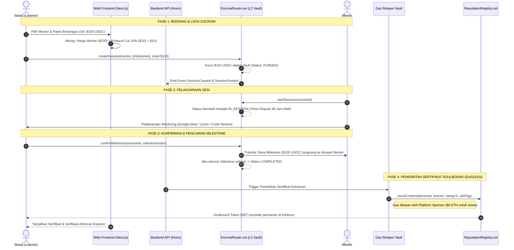
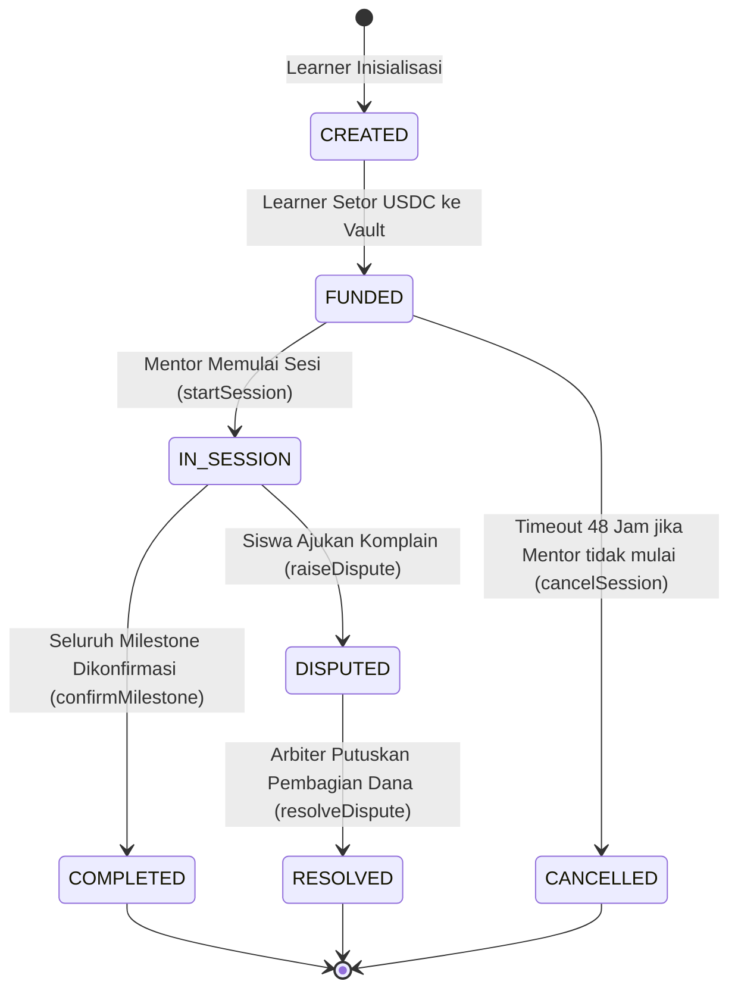

# TRUST LESSON — SYSTEMATICS & PROTOCOL LIFECYCLE
**Dokumen Sistematika Kerja Protokol & Alur Sistem** • **Version:** 2.0.0 • **Network:** Arbitrum Sepolia / Arbitrum One

---

## 1. PENDAHULUAN & PRINSIP SISTEMATIKA

Trust Lesson menyelesaikan masalah ketidakpercayaan (trust dilemma) dalam ekosistem edukasi dan bimbingan peer-to-peer (P2P). Pada sistem konvensional Web2:
- Siswa takut ditipu setelah transfer uang di muka.
- Mentor takut tidak dibayar setelah sesi mentoring selesai.
- Platform Web2 memotong komisi sangat besar (20% – 33%) dari hak mentor.

Trust Lesson menerapkan **sistematika terdesentralisasi berbasis Smart Contract Escrow di Arbitrum L2** yang menjamin:
1. Uang siswa aman terkunci di smart contract hingga materi terbukti selesai.
2. Mentor dijamin mendapat 100% dari tarif yang ia tentukan.
3. Seluruh gas fee blockchain disubsidi 100% oleh platform sponsor vault ($0 ETH untuk pengguna).
4. Sertifikat kompetensi diterbitkan secara on-chain sebagai Soulbound Token (SBT) yang tidak bisa dipalsukan.

---

## 2. SISTEMATIKA ALUR PENGGUNA (END-TO-END USER JOURNEYS)



---

## 3. FINITE STATE MACHINE ESCROW (`contracts/EscrowRouter.sol`)

Status sesi dalam smart contract dikelola oleh state machine ketat untuk memastikan tidak ada dana yang bisa dicairkan tanpa otorisasi.



### 3.1 Tabel Transisi Status Smart Contract

| Status Asal | Aksi / Fungsi | Pemanggil Diizinkan | Kondisi / Prasyarat | Status Akhir | Efek Finansial |
| :--- | :--- | :--- | :--- | :--- | :--- |
| **None** | `createSession()` | Learner | Milestones 1–10, `allowance` USDC cukup | `FUNDED` | USDC ditarik dari Learner ke Vault Escrow |
| **FUNDED** | `startSession()` | Mentor | Hanya mentor yang terdaftar di sesi | `IN_SESSION` | Deadline dispute 48 jam mulai berjalan |
| **FUNDED** | `cancelSession()` | Learner | Telah lewat 48 jam sejak dibuat tanpa dimulai | `CANCELLED` | Dana refund 100% dikembalikan ke Learner |
| **IN_SESSION** | `confirmMilestone()` | Learner | Milestone belum pernah dicairkan | `IN_SESSION` / `COMPLETED` | Dana milestone ditransfer langsung ke wallet Mentor |
| **IN_SESSION** | `raiseDispute()` | Learner | Sesi masih aktif berjalan | `DISPUTED` | Sisa dana dibekukan permanen menunggu juri |
| **DISPUTED** | `resolveDispute()` | Arbiter / Admin | Parameter `releasePercent` (0–100%) | `RESOLVED` | Dana dibagi: X% ke Mentor, (100-X)% ke Learner |

---

## 4. SISTEMATIKA PEMBAGIAN DANA & EKONOMI PROTOKOL

### 4.1 Jaminan 100% Penghasilan Mentor
Platform menjamin **Mentor menerima 100% penuh** dari tarif yang mereka tetapkan tanpa potongan sepeser pun.
- Jika mentor memasang tarif **$50.00 USDC**, mentor akan menerima bersih **$50.00 USDC**.

### 4.2 Protocol Cut (Biaya Operasional Platform 10%)
Biaya operasional platform dihitung secara transparan di atas harga mentor dan dibayarkan oleh siswa saat checkout:

$$\text{Total Bayar Siswa} = \text{Tarif Mentor} + (\text{Tarif Mentor} \times 10\%)$$

### 4.3 Matriks Simulasi Finansial
| Tarif Mentor (Base) | Protocol Cut (10%) | Gas Fee Arbitrum | Total Bayar Siswa | Diterima Mentor | Masuk Treasury Platform |
| :---: | :---: | :---: | :---: | :---: | :---: |
| **$25.00 USDC** | $2.50 USDC | **$0.00 (SPONSORED)** | **$27.50 USDC** | **$25.00 USDC** | $2.50 USDC |
| **$50.00 USDC** | $5.00 USDC | **$0.00 (SPONSORED)** | **$55.00 USDC** | **$50.00 USDC** | $5.00 USDC |
| **$100.00 USDC** | $10.00 USDC | **$0.00 (SPONSORED)** | **$110.00 USDC** | **$100.00 USDC** | $10.00 USDC |
| **$250.00 USDC** | $25.00 USDC | **$0.00 (SPONSORED)** | **$275.00 USDC** | **$250.00 USDC** | $25.00 USDC |

### 4.4 Pengelolaan Treasury (`PLATFORM_TREASURY_WALLET`)
Akumulasi potongan 10% ditampung di smart contract dan dapat ditarik oleh pemilik protokol ke alamat treasury resmi:
- **Treasury Address:** `0x656c943c3a8BB5d5F7306CC5ED66C3a938Cb75eC`
- **Fungsi Penarikan:** `EscrowRouter.withdrawFees(toAddress)` (terproteksi `onlyOwner`).

---

## 5. SISTEMATIKA SENGKETA (DISPUTE) & SLASHING STAKE

Jika terjadi wanprestasi (mentor tidak hadir, materi tidak sesuai, atau siswa mangkir):

1. **Pengajuan Sengketa (`raiseDispute`):**
   - Siswa menekan tombol *"Raise Dispute"* di dashboard.
   - Bukti pendukung (chat log, rekaman meeting, screenshot) diunggah dan dienkripsi ke IPFS via Pinata, menghasilkan `evidenceHash` (bytes32).
   - Status sesi berubah menjadi `DISPUTED`. Seluruh sisa dana di escrow dibekukan seketika.

2. **Adjudikasi Arbiter Independen (`resolveDispute`):**
   - Arbiter resmi platform memeriksa bukti on-chain.
   - Arbiter memasukkan persentase penyelesaian (`releasePercent`):
     - **Mentor bersalah total (0%):** 100% sisa dana escrow direfund ke siswa.
     - **Pekerjaan selesai sebagian (50%):** 50% dana diberikan ke mentor, 50% dikembalikan ke siswa.
     - **Siswa komplain palsu (100%):** 100% dana dilepas ke mentor.

3. **Mekanisme Slashing Stake Mentor (`contracts/MentorStaking.sol`):**
   - Mentor yang ingin mendapatkan centang verifikasi (*Verified Badge*) wajib melakukan staking minimal **100 USDC**.
   - Jika mentor terbukti melakukan penipuan pada sesi yang disengketakan, smart contract `EscrowRouter` secara otomatis memanggil fungsi `MentorStaking.slash()` untuk memotong saldo stake mentor sebagai kompensasi kerugian siswa.
   - **Timelock Penarikan Stake 7 Hari:** Mentor tidak bisa langsung menarik stakenya saat ada sesi berjalan (mencegah *exit scam*).

---

## 6. SISTEMATIKA SERTIFIKAT SOULBOUND TOKEN (SBT)

1. **Kriteria Kelulusan:** Diterbitkan hanya saat status sesi mencapai `COMPLETED` (semua milestone terkonfirmasi).
2. **Penerbitan Gasless:**
   - Siswa tidak perlu menandatangani transaksi MetaMask atau membayar ETH.
   - Backend relayer platform (`lib/gasSponsor.js`) memanggil fungsi `ReputationRegistry.issueCredential()`.
   - Gas fee Arbitrum L2 sepenuhnya ditanggung oleh `PLATFORM_SPONSOR_WALLET` (`0xf2cE53...`).
3. **Sifat Soulbound (Non-Transferable):**
   - Sertifikat terikat secara permanen pada wallet address siswa.
   - Tidak memiliki fungsi `transfer()`, `transferFrom()`, atau `approve()`, sehingga tidak dapat diperjualbelikan.
4. **Verifikasi Publik:**
   - Siapa pun (HRD, perusahaan, publik) dapat memverifikasi keabsahan sertifikat melalui URL `/certificate/[id]` yang terhubung langsung ke Arbiscan Explorer.

---

---

## 7. SISTEMATIKA KONTROL AKSES KURSUS VIDEO & DOKUMEN MATERI

Trust Lesson menerapkan arsitektur *Access-Gating* ganda untuk melindungi materi intelektual mentor dari pembajakan dan menjamin konten hanya dapat diakses setelah pembayaran milestone escrow terkonfirmasi di Arbitrum One:

### A. Alur Unggah Berkas & Penyimpanan Terproteksi (Tier 1: Cloudflare Enterprise)
1. **Video Pembelajaran (Cloudflare Stream):**
   - Mentor mengunggah berkas video rekaman (MP4, MOV, WebM) langsung melalui endpoint `/api/modules/upload-video`.
   - Sistem menyimpan identifier unik `videoUid` (bukan URL publik permanen). Non-paying users tidak dapat mengakses URL streaming mentah.
2. **Dokumen & Modul Kurikulum (Cloudflare R2):**
   - Berkas slide, PDF, dan arsip latihan diunggah ke private bucket Cloudflare R2 dengan penamaan terisolasi: `modules/{moduleId}/{uuid}-{filename}`.
   - Database hanya menyimpan object key privat, bukan URL publik.
3. **Penerbitan Akses Terbatas Waktu (*Time-Expiring Signed Tokens*):**
   - Pemutaran video meminta token via `GET /api/modules/:id/playback-token`. Jika pembayaran berstatus `FUNDED` / `IN_SESSION` / `COMPLETED`, backend menerbitkan **Signed Token Cloudflare Stream** berlaku selama **1 jam (3.600 detik)**.
   - Unduhan dokumen meminta tautan via `GET /api/modules/:id/resources/:resourceId/download`. Jika terkonfirmasi, diterbitkan **Presigned URL AWS SigV4 R2** berlaku selama **15 menit (900 detik)**.
   - Permintaan unauthenticated atau unpaid secara konsisten menghasilkan respon **`403 Forbidden` (`PAYMENT_REQUIRED`)**.

### B. Opsi Alternatif Hemat Biaya (Tier 2: YouTube Unlisted & Google Drive Restricted)
Untuk mentor yang memiliki kendala biaya infrastruktur cloud, platform menyediakan tier alternatif bebas biaya tanpa mengurangi proteksi gerbang escrow:
1. **Tautan Video YouTube (Mode Tidak Publik / Unlisted):**
   - Video diatur sebagai *Unlisted* di YouTube Studio sehingga tidak terindeks di mesin pencarian publik.
   - Portal kelas hanya merender iframe pemutar video kepada siswa yang telah membayar. Calon siswa melihat status *Gated by Smart Contract* dan overlay terkunci.
2. **Tautan Berkas Google Drive (Mode Akses Terbatas / Dibatasi):**
   - Mentor mengatur dokumen ke mode *Viewer* bagi pemegang tautan (aman karena tautan hanya dibuka di dashboard kelas siswa berbayar) atau *Restricted* ke email siswa terdaftar.
3. **Panduan Terintegrasi dalam Aplikasi (*Interactive In-App Guide*):**
   - Formulir pembuatan modul menyediakan panduan langkah demi langkah (*Step-by-Step Upload Guide*) yang dapat dibuka mentor kapan saja.

### C. Verifikasi Tampilan Siswa Pra-Publikasi (*Pre-Publish Student View Verification*)
Mentor dapat melakukan simulasi tampilan kurikulum sebelum menerbitkan penawaran:
- **Mode Siswa Belum Membayar (*Unpaid Learner View*):** Menampilkan kartu modul terkunci, pemutar video dengan pesan keharusan setoran escrow, dan tombol unduhan non-aktif.
- **Mode Siswa Sudah Membayar (*Paid Learner View*):** Memverifikasi bahwa video dapat diputar secara lancar dan dokumen dapat diunduh tanpa kendala.

---

## 8. RINGKASAN KEUNGGULAN SISTEMIK TRUST LESSON

```text
┌────────────────────────────────────────────────────────────────────────┐
│                      SISTEMATIKA TRUST LESSON                          │
├────────────────────────────────┬───────────────────────────────────────┤
│ Fitur Protokol                 │ Nilai Tambah / Keuntungan             │
├────────────────────────────────┼───────────────────────────────────────┤
│ Non-Custodial Smart Escrow     │ Dana 100% aman di blockchain L2       │
│ Zero Gas Fee for Users         │ Platform Relayer mensubsidi gas L2    │
│ 100% Mentor Earning Guarantee  │ Mentor menerima hak penuh tanpa potong│
│ 10% Protocol Cut (Buyer-side)  │ Transparan dan mendanai infrastruktur │
│ Dual-Tier Gated Content        │ Cloudflare Stream/R2 + Free YouTube/GD│
│ Signed URL Expiry Security     │ Token video 1 jam & berkas 15 menit   │
│ Pre-Publish Student Simulator  │ Mentor dapat memverifikasi gating     │
│ Soulbound Token Reputation     │ Portofolio kompetensi anti-pemalsuan  │
│ Mentor Staking & Slashing      │ Perlindungan modal siswa dari fraud   │
│ Single-Variable Switcher       │ Migrasi instan Testnet <-> Mainnet    │
└────────────────────────────────┴───────────────────────────────────────┘
```
